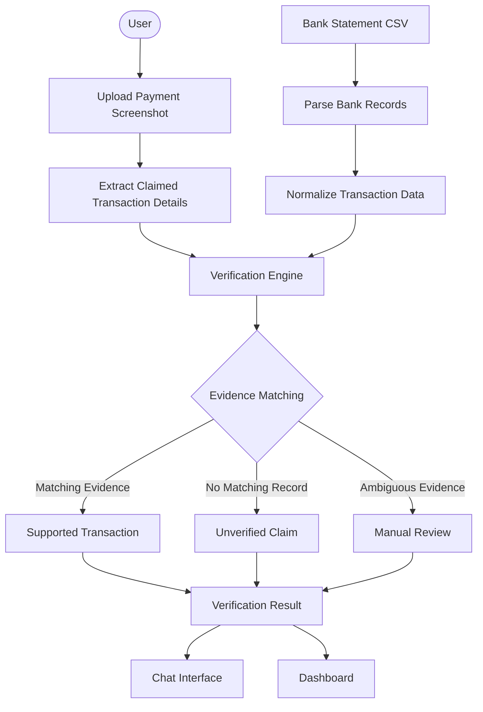
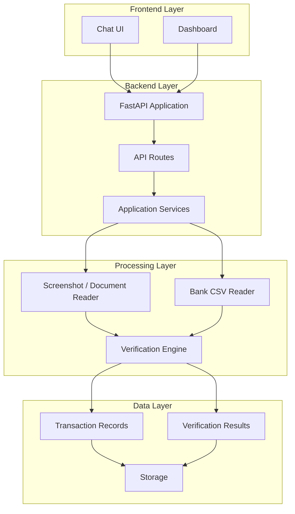

# ChitMirror

<p align="center">
  <strong>Screenshot In. Verified Ledger Out.</strong>
  <br/>
  <em>Turning payment claims into evidence-based verification.</em>
</p>

<p align="center">
  
  
  
  
  
</p>

---

## 01. What is ChitMirror?

**ChitMirror is an evidence-based payment verification platform designed to identify whether a claimed digital payment is supported by actual financial transaction records.**

In today's digital payment ecosystem, a screenshot is frequently treated as proof of payment. However, screenshots can be edited, duplicated, manipulated, or generated without an actual transfer of money.

ChitMirror approaches this problem differently.

Rather than trusting the appearance of a payment screenshot, the platform aims to extract its transaction details and reconcile them against independent bank statement evidence.

The result is a structured verification workflow that helps users distinguish between supported, unsupported, and inconclusive payment claims.

<p align="center">
  <strong>A screenshot is a claim. A matching transaction record is evidence.</strong>
</p>

## 02. The Problem

Digital payments have simplified transactions, but they have also created a verification gap.

Consider a situation where someone shares a payment screenshot claiming that ₹5,000 has been transferred.

The receiver sees a successful payment screen, but has no independent confirmation that the amount actually reached their account.

Common problems include:

- **Fake screenshots:** Payment screens can be edited to display fabricated amounts or transaction details.
- **Duplicate claims:** The same transaction screenshot can be reused to claim multiple payments.
- **Amount manipulation:** The amount displayed may not match the actual transaction.
- **Invalid references:** Transaction IDs or UTR numbers may be incorrect or fabricated.
- **Unconfirmed payments:** A screenshot may indicate success without sufficient evidence of settlement.
- **Manual verification:** Checking transactions individually consumes time and effort.

The fundamental problem is simple:

**How can someone verify a payment without blindly trusting the screenshot provided by the person claiming to have paid?**

## 03. Our Approach

ChitMirror introduces a reconciliation-based approach.

Instead of making a decision based only on image appearance, the platform uses two distinct sources of information:

| Input | Purpose |
|---|---|
| Payment screenshot | Provides the claimed transaction details |
| Bank statement CSV | Provides independent transaction evidence |

The platform is designed to extract transaction attributes from the screenshot, normalize available bank records, compare the information, and produce an evidence-based result.

This makes verification more meaningful than simply detecting whether an image looks authentic.

## 04. Product Experience

ChitMirror provides two independent interfaces that communicate with the same backend.

### Chat Interface

The chat interface is designed to provide a simple and approachable verification experience.

Users can interact with the verification workflow without needing to understand the underlying transaction reconciliation process.

**Planned capabilities:**
- Payment evidence submission.
- Transaction-related interaction.
- Verification status presentation.
- Clear explanations of verification outcomes.

<p align="center">
  
  <br/>
  <sub>ChitMirror Chat Interface — replace with an actual application screenshot.</sub>
</p>

### Verification Dashboard

The dashboard provides a structured view of transaction and verification information.

It is designed to make financial evidence easier to inspect and understand.

**Planned capabilities:**
- Transaction overview.
- Verification status monitoring.
- Transaction-level information.
- Ledger-oriented presentation.
- Scenario and evidence inspection.

<p align="center">
  
  <br/>
  <sub>ChitMirror Dashboard — replace with an actual application screenshot.</sub>
</p>

## 05. How ChitMirror Works

The central concept is evidence-based transaction reconciliation.



### Step 1 — Evidence Submission

The user submits a payment screenshot or supported payment document.

The document acts as the source of the transaction claim.

### Step 2 — Transaction Extraction

The reader module processes the supplied evidence and extracts relevant transaction attributes.

Examples include:
- Transaction reference or UTR.
- Payment amount.
- Transaction date and time.
- Available sender and receiver details.
- Displayed payment status.

### Step 3 — Bank Statement Processing

The user supplies an appropriate bank statement CSV.

The reader processes available transaction records and converts them into a consistent structure for comparison.

### Step 4 — Transaction Reconciliation

The verification engine compares the extracted payment claim with available bank statement evidence.

Possible comparison attributes include:
- Transaction reference.
- Amount.
- Date and time.
- Available account or party information.
- Duplicate transaction references.

### Step 5 — Verification Result

The system produces an outcome based on the evidence available.

| Result | Meaning |
|---|---|
| Supported | Matching transaction evidence was found. |
| Unverified | No sufficient matching evidence was found. |
| Inconclusive | Available information is insufficient or conflicting. |
| Manual Review | Further investigation is required. |

An absent transaction record does not automatically establish fraud. It may also result from processing delays, incomplete statements, or unsupported formats.

## 06. System Architecture

ChitMirror uses a modular architecture to separate the frontend applications, backend services, evidence readers, verification logic, and storage.



*This diagram represents the intended integrated architecture. The complete processing and API pipeline remains subject to implementation and integration.*

### Architecture Components

| Component | Responsibility |
|---|---|
| Chat UI | User interaction and evidence submission |
| Dashboard | Structured verification information |
| FastAPI | Backend application and HTTP communication |
| API Layer | Defines communication contracts |
| Reader Modules | Processes payment evidence and bank records |
| Verification Engine | Reconciles claimed and recorded transactions |
| Services | Coordinates application logic |
| Storage | Manages transaction and verification data |

### Why This Architecture?

- **Separation of concerns:** Each module has a clearly defined responsibility.
- **Independent interfaces:** Chat and dashboard can evolve separately.
- **Modularity:** Reader and verification components can be improved independently.
- **Testability:** Individual components can be tested without requiring the entire system.
- **Extensibility:** Additional document formats and reconciliation methods can be introduced later.

## 07. Technology Stack

| Technology | Role |
|---|---|
| Python 3.12+ | Core backend language |
| FastAPI | Backend API framework |
| Uvicorn | ASGI server |
| HTML / CSS / JavaScript | Frontend interfaces |
| Pytest | Backend testing |
| Playwright | Browser automation and UI testing |
| CSV | Bank statement input format |
| Mermaid | Architecture documentation |

**Development approach:** Independent frontend and backend workspaces, shared API contracts, modular services, and automated testing.

No Node.js build step is required.

## 08. Repository Structure

```text
ChitMirror/
│
├── backend/
│   ├── main.py
│   ├── readers/
│   ├── services/
│   ├── storage/
│   ├── api/
│   └── engine/
│
├── chat-ui/
│   ├── index.html
│   ├── styles.css
│   ├── app.js
│   └── config.js
│
├── dashboard/
│   ├── index.html
│   ├── styles.css
│   ├── app.js
│   └── config.js
│
├── contracts/
│   └── API contracts and examples
│
├── data/
│   └── Test fixtures and scenarios
│
├── tests/
│   ├── test_app.py
│   └── ui/
│
├── docs/
│   └── assets/
│       ├── chat-ui.png
│       ├── dashboard.png
│       └── architecture.png
│
├── requirements-dev.txt
├── .env.example
├── .gitignore
└── README.md
```

*The tree illustrates the intended project organization. Some directories and modules may be introduced as integration progresses.*

## 09. Getting Started

Follow these instructions to run ChitMirror locally.

### Prerequisites

- Python 3.12 or newer.
- Git.
- VS Code or another code editor.
- Windows, macOS, or Linux.

### Clone the Repository

```bash
git clone https://github.com/Dhyan-S-Kanapadi/REWIRED_REW-M2EMFD_MWRTMB.git

cd REWIRED_REW-M2EMFD_MWRTMB
```

### Create a Virtual Environment

**Windows PowerShell**

```powershell
python -m venv .venv
```

### Install Dependencies

```powershell
.\.venv\Scripts\python -m pip install -r requirements-dev.txt
```

### Start the Backend

```powershell
.\.venv\Scripts\python -m uvicorn backend.main:app --reload
```

### Access the Application

| Service | Address |
|---|---|
| Chat Interface | http://127.0.0.1:8000/chat/ |
| Dashboard | http://127.0.0.1:8000/dashboard/ |
| API Documentation | http://127.0.0.1:8000/docs |
| Health Check | http://127.0.0.1:8000/health |

### macOS / Linux

Use the following commands instead of the Windows virtual environment paths:

```bash
python3 -m venv .venv

.venv/bin/python -m pip install -r requirements-dev.txt

.venv/bin/python -m uvicorn backend.main:app --reload
```

## 10. API Configuration

Both frontend applications communicate directly with the backend.

Each frontend maintains its own `config.js`.

Default configuration:

```javascript
window.CHITMIRROR_API_BASE = "";
```

An empty value means the frontend uses the same origin.

To use another backend URL:

```javascript
window.CHITMIRROR_API_BASE = "http://127.0.0.1:8000";
```

When the frontend and backend use separate origins, configure appropriate CORS policies in FastAPI.

### Current API Implementation

The current backend scaffold exposes:

```http
GET /health
```

Shared API contracts and example payloads are maintained in the `contracts/` directory.

The remaining verification API implementation and engine integration are part of the development work.

## 11. Testing and Quality Assurance

Financial verification requires careful handling of incorrect, incomplete, and conflicting information.

ChitMirror uses automated backend and browser testing to validate the application.

### Backend Tests

```powershell
.\.venv\Scripts\python -m pytest tests/test_app.py
```

### Install Playwright Chromium

```powershell
.\.venv\Scripts\python -m playwright install chromium
```

### UI Tests

Start the backend in one terminal.

Run the following command in another:

```powershell
.\.venv\Scripts\python -m pytest tests/ui --base-url http://127.0.0.1:8000
```

### Manual QA Checklist

- [ ] Chat page loads correctly.
- [ ] Dashboard loads correctly.
- [ ] Backend health endpoint responds.
- [ ] Both pages use the configured backend URL.
- [ ] Mobile-width chat layout is readable.
- [ ] Dashboard works at projector resolution.
- [ ] Backend disconnection produces a readable error.
- [ ] Invalid input is handled safely.
- [ ] Verification results are based on available evidence.
- [ ] No unsupported success claims are displayed.

CI is configured to run backend checks and Chromium smoke tests.

## 12. Security and Trust Considerations

Since ChitMirror handles financial evidence, security and data integrity are essential.

Important considerations include:

- Validate uploaded file types and sizes.
- Reject malformed or unsupported documents.
- Avoid storing unnecessary financial information.
- Protect uploaded files and extracted transaction details.
- Never request banking passwords, OTPs, or PINs.
- Use secure secret management.
- Maintain traceable verification records.
- Distinguish between verified, unverified, and inconclusive outcomes.
- Implement authentication and access controls before production deployment.

**Verification limitation:** A bank statement CSV provides evidence from the supplied file, not a cryptographically authenticated live connection to the bank. ChitMirror must not represent CSV reconciliation as direct bank confirmation.

## 13. Development Workflow

ChitMirror follows an issue-driven collaborative development process.

Each contributor works on an individual issue and feature branch.

### Branch Naming

```text
T##-short-name
```

### Contribution Workflow

1. Pick an assigned GitHub issue.
2. Create a dedicated feature branch.
3. Implement the assigned functionality.
4. Run relevant automated tests.
5. Submit a pull request referencing the issue.
6. Request a teammate review.
7. Merge after the required checks pass.

Pull requests should reference their corresponding issue using:

```text
Closes #<issue-number>
```

A maximum of four issues should remain in flight simultaneously to reduce integration conflicts.

## 14. Team Contributions

ChitMirror was developed collaboratively by a four-person team during a six-hour hackathon.

| Contributor | Responsibility | Workspace |
|---|---|---|
| Member A | Reader and verification modules, tests | `backend/`, `tests/` |
| Member B | API contracts, services, storage and engine integration | `backend/` |
| Member C | Chat interface, demo and pitch | `chat-ui/` |
| Member D | Dashboard, fixtures and scenarios | `dashboard/`, `data/` |

*Replace the contributor labels with actual GitHub usernames or team member names.*

## 15. Current Project Status

ChitMirror is an actively developed hackathon prototype.

| Area | Current Status |
|---|---|
| Backend application scaffold | Available |
| Chat frontend | Independent interface |
| Dashboard frontend | Independent interface |
| API contracts | Available |
| Health endpoint | Implemented |
| Reader integration | Development |
| Verification engine integration | Pending integration |
| Bank CSV reconciliation | Pending integration |
| Complete end-to-end verification | Pending integration |
| Production deployment | Future scope |

The architecture and interfaces establish the foundation for the complete verification platform. The full transaction verification workflow should be considered operational only after its backend integration and end-to-end tests pass.

## 16. Future Roadmap

ChitMirror can grow into a more comprehensive payment evidence verification platform.

| Planned Enhancement | Objective |
|---|---|
| Advanced OCR | Improve transaction extraction from screenshots |
| PDF Processing | Support bank statement PDFs |
| Multi-Bank CSV Support | Normalize different bank statement formats |
| Intelligent Reconciliation | Improve transaction matching |
| Duplicate Detection | Identify repeated transaction references |
| UPI Reference Matching | Improve UPI transaction reconciliation |
| Authorized API Integrations | Explore supported payment and banking data sources |
| Audit Trail | Maintain verification history |
| Authentication | Introduce secure user accounts |
| Cloud Deployment | Provide secure access to the platform |

These enhancements are proposed future capabilities, not claims of existing functionality.

## 17. Important Limitations

ChitMirror is not a banking institution, payment gateway, or direct banking verification service.

Its verification accuracy depends on the quality, completeness, and reliability of the supplied evidence.

In particular:

- A screenshot alone cannot prove settlement.
- A missing CSV record does not automatically prove fraud.
- Bank statement formats may differ.
- Transaction processing delays can affect reconciliation.
- A supplied CSV is not automatically authenticated by the issuing bank.
- Production deployment requires additional security, privacy, and reliability controls.

The objective is to provide evidence-based assistance, not to make unsupported financial guarantees.

## 18. Project Vision

We believe payment verification should be based on evidence rather than appearance.

ChitMirror aims to reduce the trust gap in digital transactions by bringing transaction claims and independent financial records into one understandable workflow.

From individual payments to group collections and business transactions, the long-term vision is to make payment verification more transparent, accessible, and reliable.

<p align="center">
  <strong>ChitMirror</strong>
  <br/>
  Screenshot In. Verified Ledger Out.
  <br/><br/>
  <em>Building trust through evidence, not assumptions.</em>
</p>

---
